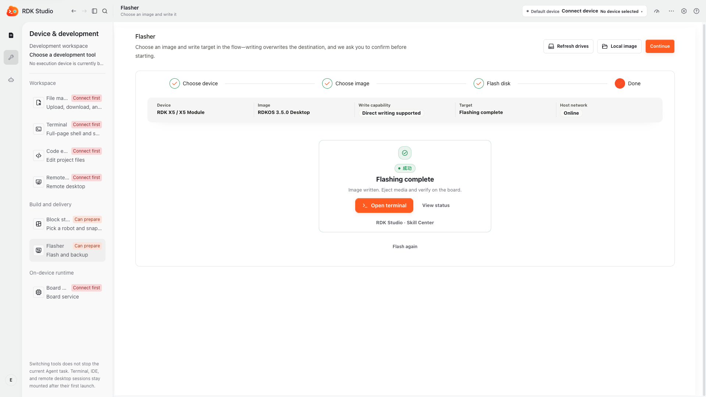
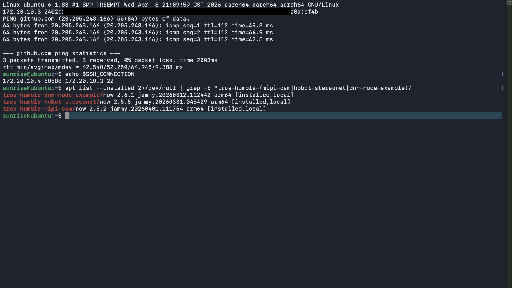
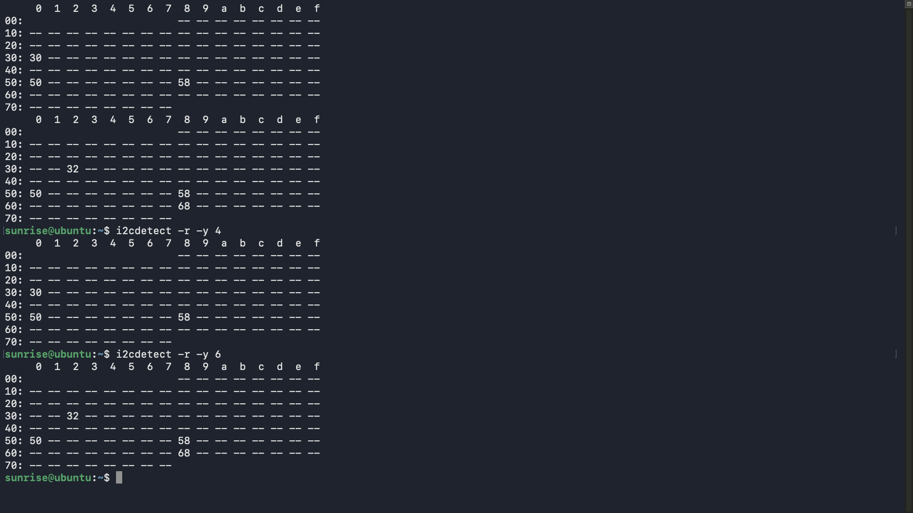
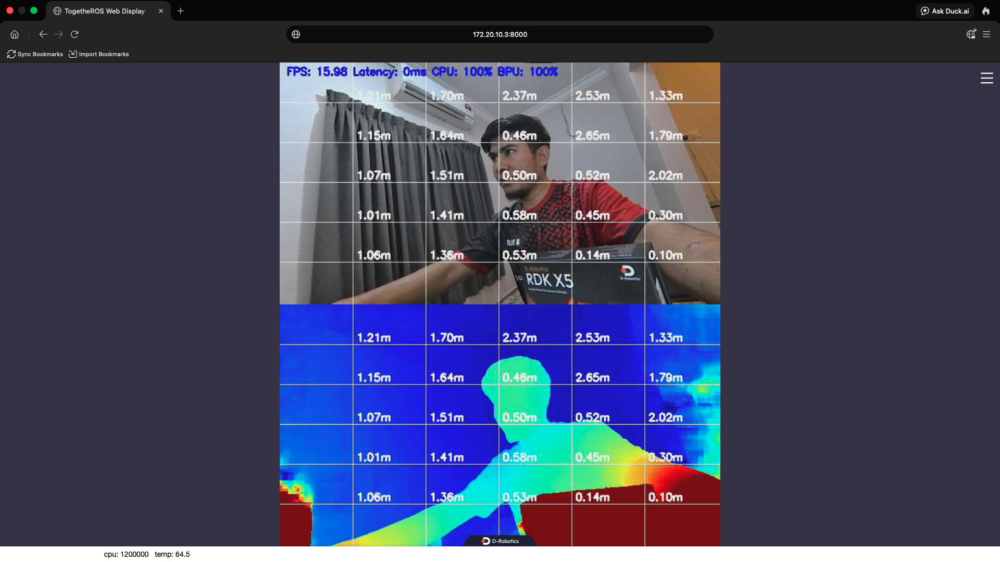
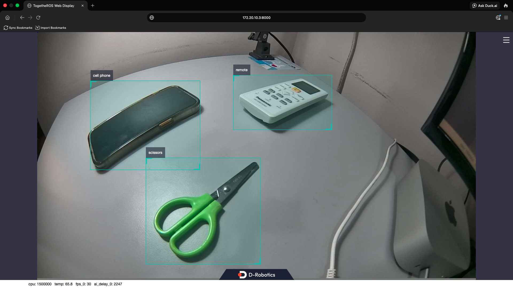

# LakeRover — AI Lake Sampling Rover on RDK X5

> *Dari Tasik ke Data. Dari Data ke Tindakan.* — From Lake to Data. From Data to Action.

LakeRover is an autonomous water-sampling rover that helps schools and communities monitor lake health. It runs on the **D-Robotics RDK X5** with the **RDK Stereo Camera**, using BPU-accelerated AI to detect floating debris and obstacles while estimating depth in real time. A ROS 2 stack links perception and mission logic to an ArduPilot autopilot for navigation and failsafe. Water samples are analysed by a university laboratory, and live telemetry streams over 4G and LoRa to an iPad app.

This repository is my entry for the **Robotics Dream Keeper Challenge — 2026 Winter**.

| Stage | Status | Evidence |
| --- | --- | --- |
| Stage 1 — Ignite | ✅ Completed | [Stage 1 evidence](#stage-1--ignite) |
| Stage 2 — Build | ⚪ Not started | — |
| Stage 3 — Launch | ⚪ Not started | — |

---

## Hardware

| Item | Notes |
| --- | --- |
| D-Robotics RDK X5 (8GB) | 8× Cortex-A55 @ 1.5 GHz, 10 TOPS BPU |
| RDK Stereo Camera (SC230AI, dual 2MP) | Connected to both MIPI CSI ports |
| microSD card, 64 GB (MakerDisk A2) | System boot medium |
| USB-C power supply | Stage 1 ran on a 5.1V/3A supply; 5V/5A recommended for full AI load |
| Development computer | macOS, RDK Studio |

## Software

| Component | Version |
| --- | --- |
| RDK OS image | `rdk-x5-ubuntu22-preinstalled-desktop-3.5.0-arm64` |
| Ubuntu / kernel | 22.04, Linux 6.1.83 aarch64 |
| TogetheROS.Bot (tros.b) | Humble |
| `tros-humble-mipi-cam` | 2.5.2 |
| `tros-humble-hobot-stereonet` | 2.5.5 |
| `tros-humble-dnn-node-example` | 2.6.1 |

Check package versions on the board:

```bash
apt list --installed 2>/dev/null | grep -E "tros-humble-(mipi-cam|hobot-stereonet|dnn-node-example)/"
```

---

## Quick Start

### 1. Flash the system image

1. Insert the microSD card into the computer.
2. Open **RDK Studio**, select **RDK X5**, and follow the flashing wizard.
3. Insert the card into the RDK X5 and power on with the 5V/5A supply.
4. **Green LED on** means power is OK; **orange LED blinking** means boot is complete.

### 2. Connect to the network

Ethernet works out of the box with DHCP. For Wi-Fi, on the board (HDMI desktop or debug serial at 115200 baud):

```bash
sudo srpi-config            # System Options → Wireless LAN
# or
sudo nmcli device wifi connect "<SSID>" password "<PASSWORD>"
```

Find the board's IP address and confirm internet access:

```bash
hostname -I
ping -c 3 github.com
```

### 3. SSH in from the development computer

```bash
ssh sunrise@<BOARD_IP>      # default password: sunrise (on an iPhone hotspot the IP looks like 172.20.10.x)
```

Change the default password after first login:

```bash
passwd
```

### 4. Verify the stereo camera (MIPI)

```bash
i2cdetect -r -y 4
i2cdetect -r -y 6
```

Addresses such as `0x30`, `0x32` and `0x50` mean the camera is connected correctly. On my board: bus 4 showed `0x30, 0x50, 0x58`; bus 6 showed `0x32, 0x50, 0x58, 0x68`.

### 5. Run stereo depth (sensor demo)

```bash
source /opt/tros/humble/setup.bash
ros2 launch hobot_stereonet stereonet_model_web_visual_v2.1.launch.py \
  mipi_image_width:=640 mipi_image_height:=352 mipi_lpwm_enable:=True \
  mipi_image_framerate:=30.0 need_rectify:=False \
  height_min:=-10.0 height_max:=10.0 pc_max_depth:=5.0
```

Open `http://<BOARD_IP>:8000` in a browser on the same network to see the depth view. Stop with `Ctrl+C`.

### 6. Run YOLO object detection (first AI task)

```bash
source /opt/tros/humble/setup.bash
export CAM_TYPE=mipi
ros2 launch dnn_node_example dnn_node_example.launch.py \
  dnn_example_config_file:=config/yolov2workconfig.json \
  dnn_example_image_width:=1920 dnn_example_image_height:=1080
```

Open `http://<BOARD_IP>:8000` to see live detections. To try a newer model, change the config to `config/yolov8workconfig.json`.

Fallback without a live camera (local image injection):

```bash
ros2 launch dnn_node_example dnn_node_example_feedback.launch.py \
  dnn_example_config_file:=config/yolov2workconfig.json \
  dnn_example_image:=config/target.jpg
```

### Stop and recover

| Action | Command |
| --- | --- |
| Stop a running demo | `Ctrl+C` in the terminal |
| Kill leftover ROS 2 nodes | `pkill -f ros2` |
| Safe shutdown | `sudo shutdown -h now` (wait for LEDs before unplugging) |
| Reboot | `sudo reboot` |

---

## Stage 1 — Ignite

| # | Deliverable | Evidence |
| --- | --- | --- |
| 1 | Flash + SSH |   |
| 2 | Sensor: RDK Stereo Camera via **MIPI CSI** (ROS 2 nodes `mipi_cam` + `hobot_stereonet`) |   |
| 3 | AI task: **YOLO object detection** on RDK X5 (detected cell phone, remote, scissors) |  |
| 4 | Community check-in | [Stage 1 thread on Discord](https://discord.com/channels/1300358874280230994/1566252507787698276) |
| 5 | Showcase PR | [PR #8](https://github.com/D-Robotics/Robotics-Dream-Keeper-Challenge-Winter/pull/8) |

**Observed performance (Stage 1 baseline):**

| Workload | Model / input | FPS | Notes |
| --- | --- | --- | --- |
| Stereo depth | StereoNet v2.1, 640×352 | 15.98 | BPU 100%, CPU 100%, SoC 64.5 °C |
| Object detection | YOLOv2, 1920×1080 camera | 30 (camera stream) | SoC 65.8 °C, `ai_delay` 2247 reported by web UI |

---

## Troubleshooting

| Problem | Fix |
| --- | --- |
| macOS says "RDK Studio" can't be verified | Gatekeeper block on a non-notarized app. Open **System Settings → Privacy & Security → Open Anyway**, or run `xattr -dr com.apple.quarantine "/Applications/RDK Studio.app"` |
| Board reboots randomly or won't boot | Use a 5V/5A USB-C supply; most phone chargers only give 5V/3A |
| No IP address / can't SSH | Check the router's client list or run `hostname -I` on the board via HDMI or the debug serial port (115200 baud) |
| `i2cdetect` shows no camera addresses | Power off, reseat both FPC cables (contacts facing the right way, left/right not swapped), power on |
| Stereo depth launch fails | Update packages: `sudo apt update && sudo apt install --only-upgrade tros-humble-mipi-cam tros-humble-hobot-stereonet` |
| Web page at `:8000` is blank | Computer and board must be on the same network; close other demos first so only one web server runs |
| YOLO with `CAM_TYPE=mipi` fails while the stereo camera is attached | Use the local-image fallback above, or stop any running stereo demo before launching YOLO |
| RDK Studio in-board flashing showed no target drive at first | Board must enter flashing mode: hold **Sleep**, then power on; data cable to the middle (QuickLink) USB-C port |
| QuickLink USB networking (`192.168.128.10`) gave no network interface on macOS | Connected HDMI + keyboard once, joined Wi-Fi (iPhone hotspot) from the desktop, then SSH over Wi-Fi |
| ROS 2 nodes crashed: `Failed to create log directory: /userdata/.roslog`; nginx `Permission denied` | `sudo mkdir -p /userdata/.roslog && sudo chown -R sunrise:sunrise /userdata/.roslog /opt/tros/humble/lib/websocket/webservice` |

---

## Repository structure

```
lakerover-rdk/
├── README.md
├── docs/
│   └── stage1/          # Stage 1 screenshots and logs
├── src/                 # ROS 2 packages (Stage 2–3)
├── launch/
├── config/
├── models/
└── tests/
```

## Security

No Wi-Fi passwords, tokens, private keys or device serial numbers are published in this repository.

## License

MIT — see `LICENSE`.

## Acknowledgements

Built on [D-Robotics RDK X5](https://developer.d-robotics.cc/en/rdkx5), [TogetheROS.Bot](https://developer.d-robotics.cc/tros_doc/en/boxs/detection/yolo), [hobot_stereonet](https://github.com/D-Robotics/hobot_stereonet) and the [RDK Model Zoo](https://github.com/D-Robotics/rdk_model_zoo).
